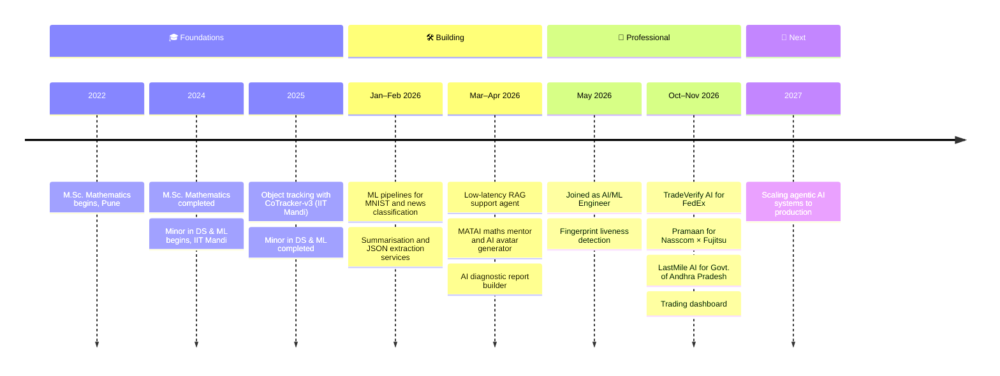
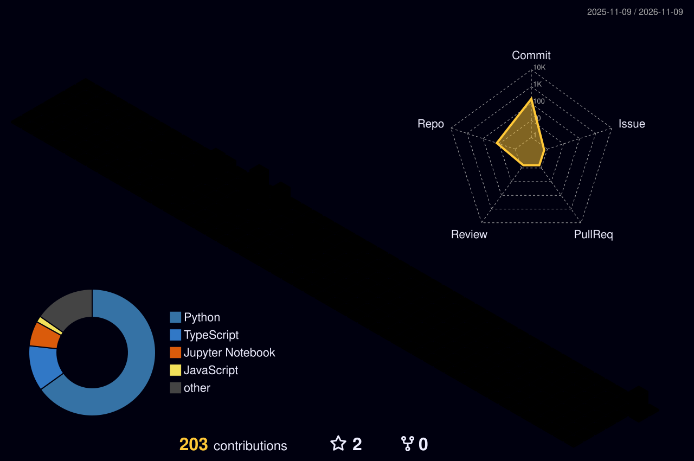

  
  
  
  

---

### 👋 About Me

I'm an **AI/ML Engineer from Pune** (since May 2026) with a postgraduate background in **Mathematics** and a minor in **Data Science & ML from IIT Mandi**. I build practical AI systems — from **RAG-powered agents** and **LLM document pipelines** to **computer vision** and classic **ML pipelines** — and ship them as working, deployed apps.

- 💼 Working as an **AI/ML Engineer** since **May 2026**
- 🔭 Currently building a **broker-integrated trading platform** (FastAPI + React) with paper trading, live market data and AI-assisted insights
- 🧠 Interested in agentic workflows, retrieval, low-latency inference and applied CV
- 📐 I bring mathematical rigor (linear algebra, statistics, optimisation) to model design
- ⚡ Fun fact: I like turning messy real-world data into clean, structured output

| ⚡ Quick Facts | |
|---|---|
| 💼 **Role** | AI/ML Engineer (May 2026 – present) |
| 📍 **Based in** | Pune, India 🇮🇳 |
| 🎓 **Background** | M.Sc. Mathematics · DS & ML @ IIT Mandi |
| 🛠️ **Building** | LLM agents · RAG pipelines · Trading platform |
| 💬 **Ask me about** | Linear algebra · RAG design · Computer vision |
| 🧮 **Formula** | *Mathematics + Code + Curiosity = AI that ships* 🚀 |

---

### 🧭 My Journey

---

### 📐 Where Maths Meets ML

  

<i>Every model I ship is linear algebra, calculus and probability underneath.</i>

| PCA | Bayes | Cross-entropy |
|:---:|:---:|:---:|
| $\Sigma v = \lambda v$ | $P(\theta \mid D) \propto P(D \mid \theta) P(\theta)$ | $L = -\sum_i y_i \log \hat{y}_i$ |

---

### 🛠️ Tech Stack

   
  

| Area | Tools |
|---|---|
| **LLMs & Agents** | Groq (Llama 3), RAG, pgvector, prompt engineering, SSE streaming |
| **Machine Learning** | scikit-learn, PCA, SVM, KNN, ensembles, TF-IDF, GridSearchCV |
| **Deep Learning & CV** | PyTorch, TensorFlow, OpenCV, CoTracker-v3 |
| **Data** | Pandas, NumPy, Matplotlib, Seaborn |
| **Backend & Deploy** | FastAPI, Streamlit, Render, Supabase, Docker |

---

### ⭐ Main Projects

| Project | What it does | Stack |
|---|---|---|
| 🛃 **TradeVerify AI** · *FedEx* · 👑 **Team Lead** | Verifies trade documents (invoice, packing list, B/L, LC) with OCR, forensics, sanctions screening and a customs review workflow | `Python` `OCR` `OpenCV` `Security` |
| 🚚 **LastMile AI** · *Govt. of Andhra Pradesh* · 👑 **Team Lead** | Predicts delivery delays, forecasts demand and optimises routes for supplies to Anganwadi centres across 15 districts | `FastAPI` `XGBoost` `React` `Leaflet` |
| 🔎 **Pramaan** · *Nasscom × Fujitsu* | Detects fake government notices in 23 Indian languages using OCR, speech-to-text, forensic rules and hybrid retrieval | `PaddleOCR` `Whisper` `RAG` `HDBSCAN` |
| 🖐️ **[Fingerprint Liveness](https://github.com/AshishLahire/contactless-fingerprint-liveness)** | Tells live fingers from spoofs in contactless fingerprint images | `PyTorch` `EfficientNet` `OpenCV` |
| 📈 **Trading Dashboard** | Broker-integrated trading terminal with live market data, paper trading and AI-assisted insights | `FastAPI` `React` `WebSockets` |
| 🎯 **[Object Tracking](https://github.com/AshishLahire/tracking_an_object_in_self_recorded_videos)** · *IIT Mandi* | Tracks any user-selected object through real-world videos, robust to motion and occlusion | `PyTorch` `CoTracker-v3` `OpenCV` |

---

### 🚀 Other Projects

- ⚡ [**Low-Latency AI Agent**](https://github.com/AshishLahire/low-latency-ai-agent): RAG support bot with streaming responses
- 🏗️ [**AI Report Builder**](https://github.com/AshishLahire/AI-Generalist): turns inspection PDFs into diagnostic reports · [demo](https://ai-generalist.onrender.com)
- 🧮 [**MATAI**](https://github.com/AshishLahire/MATAI): maths tutor that takes text, voice or image input
- 🧾 [**Reconciliation & Claims**](https://github.com/AshishLahire/marico_reconciliation): automated trade and D2C claims matching
- 🎬 [**AI Avatar Generator**](https://github.com/AshishLahire/ai_avatar): turns an idea into an avatar video · [demo](https://aiavatar-aqnxcdn6s559nhs4e6tdw5.streamlit.app/)
- 🔢 [**MNIST Classifier**](https://github.com/AshishLahire/mnist-handwritten-digits-ml): PCA with ensemble ML models
- 📰 [**News Classifier**](https://github.com/AshishLahire/News-Classification-ML-Pipeline): TF-IDF text classification
- 📄 [**Resume Summarizer**](https://github.com/AshishLahire/Resume_summarization_service): summarises resumes with AI
- 🧩 [**JSON Extractor**](https://github.com/AshishLahire/Json-Extractor): extracts structured data from text

---

### 📊 GitHub Stats

  

---

### 🏙️ My Contributions in 3D

<picture>
  <source media="(prefers-color-scheme: dark)" srcset="./profile-3d-contrib/profile-night-rainbow.svg" />
  <source media="(prefers-color-scheme: light)" srcset="./profile-3d-contrib/profile-green-animate.svg" />
  
</picture>

---

### 🎓 Education & Certifications

| | |
|---|---|
| 🎓 **Minor in Data Science & Machine Learning** | CCE, IIT Mandi · 2024–2025 |
| 🎓 **M.Sc. Mathematics** | Abasaheb Garware College, Pune · 2022–2024 |
| 📜 **AI & ML with Deep Learning** | IIT Bombay (Aavhan) |
| 🛰️ **AI & ML for Geodata Analysis** | ISRO, Dehradun |

---

### 🤝 Open to collaborations on AI agents, RAG and applied ML

⭐ *Always learning. Always building.*

