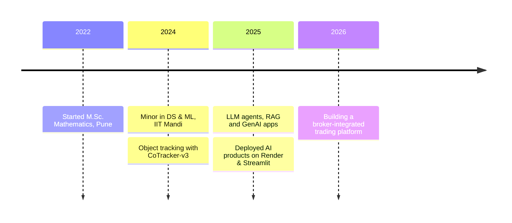

<div align="center">


<a href="https://git.io/typing-svg"></a>

<p>
  <a href="https://ashishlahire.lovable.app"></a>
  <a href="https://linkedin.com/in/ashish-lahire-186111256"></a>
  <a href="mailto:ashishlahire12@gmail.com"></a>
  
</p>

</div>

---

### 👋 About Me

I'm an **AI Engineer from Pune** with a postgraduate background in **Mathematics** and a minor in **Data Science & ML from IIT Mandi**. I build practical AI systems — from **RAG-powered agents** and **LLM document pipelines** to **computer vision** and classic **ML pipelines** — and ship them as working, deployed apps.

- 🔭 Currently building a **broker-integrated trading platform** (FastAPI + React) with paper trading, live market data and AI-assisted insights
- 🧠 Interested in agentic workflows, retrieval, low-latency inference and applied CV
- 📐 I bring mathematical rigor (linear algebra, statistics, optimisation) to model design
- ⚡ Fun fact: I like turning messy real-world data into clean, structured output

```python
class AshishLahire:
    def __init__(self):
        self.role       = "AI Engineer"
        self.based_in   = "Pune, India 🇮🇳"
        self.background = ["M.Sc. Mathematics", "DS & ML @ IIT Mandi"]
        self.building   = ["LLM agents", "RAG pipelines", "Trading platform"]
        self.ask_me     = ["Linear algebra", "RAG design", "Computer vision"]

    def formula(self):
        return "Mathematics + Code + Curiosity = AI that ships 🚀"

me = AshishLahire()
print(me.formula())
```

---

### 🧭 My Journey



---

### 📐 Where Maths Meets ML

My favourite idea, and the one behind half my projects. PCA finds the directions of greatest variance by solving an eigenvalue problem:

$$\Sigma \mathbf{v} = \lambda \mathbf{v}, \qquad \Sigma = \frac{1}{n} X^\top X$$

…and attention, the core of every LLM I build with, is just linear algebra plus a softmax:

$$\text{Attention}(Q, K, V) = \text{softmax}\left(\frac{QK^\top}{\sqrt{d_k}}\right)V$$

---

### 🛠️ Tech Stack

<p align="center">
  <br/>
  
</p>

| Area | Tools |
|---|---|
| **LLMs & Agents** | Groq (Llama 3), RAG, pgvector, prompt engineering, SSE streaming |
| **Machine Learning** | scikit-learn, PCA, SVM, KNN, ensembles, TF-IDF, GridSearchCV |
| **Deep Learning & CV** | PyTorch, TensorFlow, OpenCV, CoTracker-v3 |
| **Data** | Pandas, NumPy, Matplotlib, Seaborn |
| **Backend & Deploy** | FastAPI, Streamlit, Render, Supabase, Docker |

---

### ⭐ Main Projects

| Project | What it does | Stack |
|---|---|---|
| 🛃 **TradeVerify AI** · *FedEx* | Verifies trade documents (invoice, packing list, B/L, LC) with OCR, forensics, sanctions screening and a customs review workflow | `Python` `OCR` `OpenCV` `Security` |
| 🚚 **LastMile AI** · *Govt. of Andhra Pradesh* | Predicts delivery delays, forecasts demand and optimises routes for supplies to Anganwadi centres across 15 districts | `FastAPI` `XGBoost` `React` `Leaflet` |
| 🔎 **Pramaan** · *Nasscom × Fujitsu* | Detects fake government notices in 23 Indian languages using OCR, speech-to-text, forensic rules and hybrid retrieval | `PaddleOCR` `Whisper` `RAG` `HDBSCAN` |
| 📈 **Trading Dashboard** | Broker-integrated trading terminal with live market data, paper trading and AI-assisted insights | `FastAPI` `React` `WebSockets` |
| 🎯 **[Object Tracking](https://github.com/AshishLahire/tracking_an_object_in_self_recorded_videos)** · *IIT Mandi* | Tracks any user-selected object through real-world videos, robust to motion and occlusion | `PyTorch` `CoTracker-v3` `OpenCV` |

---

### 🚀 Other Projects

<table>
<tr>
<td width="50%" valign="top">

#### ⚡ [Low-Latency AI Support Agent](https://github.com/AshishLahire/low-latency-ai-agent)
Conversational support agent with **RAG**, **Groq (Llama 3)**, **Supabase pgvector** and **token-by-token SSE streaming** over FastAPI.

`Python` `FastAPI` `RAG` `pgvector`

</td>
<td width="50%" valign="top">

#### 🏗️ [AI Diagnostic Report Builder](https://github.com/AshishLahire/AI-Generalist)
Agentic system that turns raw inspection PDFs and thermal scans into a structured, client-ready diagnostic report. · [Live demo](https://ai-generalist.onrender.com)

`Python` `Groq` `LLM Agents` `PDF`

</td>
</tr>
<tr>
<td width="50%" valign="top">

#### 🧮 [MATAI — AI Maths Mentor](https://github.com/AshishLahire/MATAI)
Multimodal maths tutor that solves problems from **text, audio and images**.

`Python` `Multimodal` `LLM`

</td>
<td width="50%" valign="top">

#### 🧾 [Customer Reconciliation & Claims](https://github.com/AshishLahire/marico_reconciliation)
Intelligent reconciliation and claims resolution for organised trade and D2C channels.

`Python` `Data Automation`

</td>
</tr>
<tr>
<td width="50%" valign="top">

#### 🎬 [AI Avatar Video Generator](https://github.com/AshishLahire/ai_avatar)
End-to-end pipeline: idea → script → voice → HeyGen avatar video. · [Live demo](https://aiavatar-aqnxcdn6s559nhs4e6tdw5.streamlit.app/)

`Python` `Streamlit` `GenAI APIs`

</td>
<td width="50%" valign="top">

#### 🖐️ [Fingerprint Liveness Detection](https://github.com/AshishLahire/contactless-fingerprint-liveness)
EfficientNet-B3 model that detects **live vs. spoof** fingers in contactless fingerprint images.

`PyTorch` `EfficientNet` `Biometrics`

</td>
</tr>
</table>

<details>
<summary><b>📦 More projects</b></summary>
<br/>

- 🔢 [MNIST Digit Classification](https://github.com/AshishLahire/mnist-handwritten-digits-ml) — PCA + KNN/SVM/Decision Tree with ensemble voting
- 📰 [News Classification Pipeline](https://github.com/AshishLahire/News-Classification-ML-Pipeline) — TF-IDF + tuned linear models
- 📄 [Resume Summarization Service](https://github.com/AshishLahire/Resume_summarization_service) — summarise resumes with AI
- 🧩 [JSON Extractor](https://github.com/AshishLahire/Json-Extractor) — structured data extraction

</details>

---

### 📊 GitHub Stats

<div align="center">
  
  
  <br/>
  
  <br/>
  
</div>

---

### 🏙️ My Contributions in 3D

<picture>
  <source media="(prefers-color-scheme: dark)" srcset="./profile-3d-contrib/profile-night-rainbow.svg" />
  <source media="(prefers-color-scheme: light)" srcset="./profile-3d-contrib/profile-gitblue.svg" />
  
</picture>

---

### 🎓 Education & Certifications

| | |
|---|---|
| 🎓 **Minor in Data Science & Machine Learning** | CCE, IIT Mandi · 2024–2025 |
| 🎓 **M.Sc. Mathematics** | Abasaheb Garware College, Pune · 2022–2024 |
| 📜 **AI & ML with Deep Learning** | IIT Bombay (Aavhan) |
| 🛰️ **AI & ML for Geodata Analysis** | ISRO, Dehradun |

---

<div align="center">

### 🤝 Open to collaborations on AI agents, RAG and applied ML

⭐ *Always learning. Always building.*


</div>
